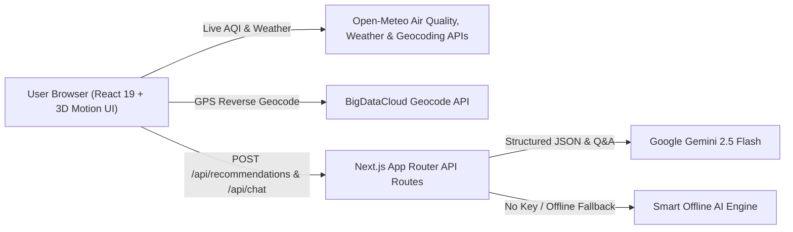

# VayuMitra — Urban Air Quality & Winter Smog Assistant

**VayuMitra** is a full-stack, real-time GenAI web application built with **Next.js (App Router)**, **Tailwind CSS**, **Framer Motion**, and **Google Gemini (`gemini-2.5-flash`)** to help families and communities navigate severe urban air pollution and winter smog.

---

## Architecture Overview



---

## Key Features

1. **100% Live Real-Time Air Quality & Weather Intelligence**
   - Fetches live **US AQI, PM2.5, PM10, NO₂**, 24-hour hourly trends, and **5-Day Smog Forecasts** from the **Open-Meteo Air Quality API** (no API key required).
   - Integrates **Open-Meteo Weather** for real-time Temperature, Humidity, Wind Speed, and **Winter Inversion / Smog Trap Risk** calculation.
   - Includes a **2-minute TTL in-memory cache** (`aqiCache`) for instant switching across saved cities.

2. **Global City / Area Search & 1-Click GPS Detection**
   - Search **any city, town, or neighborhood worldwide** via Open-Meteo Geocoding.
   - **Detect My Area** uses browser GPS + reverse geocoding to load live AQI for your exact location.
   - Customizable **Saved Cities** bar (add or remove any city, persisted in `localStorage`).

3. **3D Animated & AQI-Reactive UI**
   - **Dynamic Atmospheric Background**: Layered 3D-blur clouds and a live HTML5 Canvas particulate field that adapts color, density, and wind-drift speed to current air quality.
   - **3D Atmospheric Smog Orb & Tilt Cards**: Interactive mouse-tracking 3D perspective cards and a live Canvas particle sphere.
   - **Interactive 3D Home IAQ Floorplan**: Tap rooms (*Bedroom*, *Kitchen*, *Living Room*, *Balcony*) to inspect indoor PM2.5 estimates and toggle low-cost IAQ fixes.

4. **GenAI Action Engine + Direct Impact Explainer**
   - Uses `gemini-2.5-flash` structured JSON output (with a seamless **Smart Offline Mode** fallback) across three tabs:
     - **Low-Emission Daily Routines**
     - **Indoor Air Quality (IAQ) Hacks**
     - **Sustainable Alternatives**
   - Every recommendation includes a **"Why This Matters (Direct Impact)"** breakdown with **Personal Health Impact** and **Community & Environmental Impact** metrics.
   - **Interactive Direct-Impact Simulator** calculates live daily cigarette-equivalent exposure (`PM2.5 / 22 µg/m³`) and real-time savings as you toggle clean-air habits.

5. **Community Smog Watch & AI Smog Advisor**
   - **Community Smog Watch**: Log hyperlocal pollution spikes (garbage burning, construction dust) or neighborhood clean-air wins, with upvoting and collective ward impact.
   - **AI Smog Advisor Chat Drawer**: Context-aware Q&A grounded in your household profile and live AQI.

---

## API Endpoints & Environment Variables

| Endpoint | Method | Purpose | Validation & Security |
| :--- | :--- | :--- | :--- |
| `/api/recommendations` | `POST` | Generates 3x3 personalized cards with `Direct Impact` | Validates `profile` & `aqiData` types |
| `/api/chat` | `POST` | Context-aware family smog Q&A | Validates `question` (`<= 500` chars) & context |

| Environment Variable | Required | Description |
| :--- | :--- | :--- |
| `GEMINI_API_KEY` | Optional | Enables live `gemini-2.5-flash` server-side responses (falls back to Smart Offline Mode if unset) |

---

## Getting Started

```bash
# 1. Install dependencies
npm install

# 2. (Optional) Add your Gemini API key in .env.local
# GEMINI_API_KEY=your_api_key_here

# 3. Run development server
npm run dev
```

Open [http://localhost:3000](http://localhost:3000). You can also enter your Gemini API key directly in the UI via the **API Key** settings modal.

---

## Quality, Security, Accessibility & Testing

```bash
# TypeScript type check
npx tsc --noEmit

# ESLint check
npm run lint

# Run all 52 unit tests
npm test
```

- **Security:** HTTP security headers (`X-Content-Type-Options: nosniff`, `X-Frame-Options: DENY`, `Referrer-Policy`, `X-XSS-Protection`, `Permissions-Policy`, `Strict-Transport-Security`) configured in `next.config.ts`, plus strict payload validation, control-character sanitization, and coordinate bounds checking (`isValidCoordinates`).
- **Accessibility & Multi-Device UX:** Skip-to-main-content link, `role="dialog"` / `aria-modal="true"` with `Escape`-key closing, `role="combobox"` / `listbox` / `tablist`, `aria-pressed`, keyboard-focusable 24-hour timeline bars, `useReducedMotion` support, touch-friendly 3D cards, and a Mobile Quick-Action Bottom Dock.
- **Deployment:** Ready for 1-click deployment on **Vercel** (`npm run build`).
